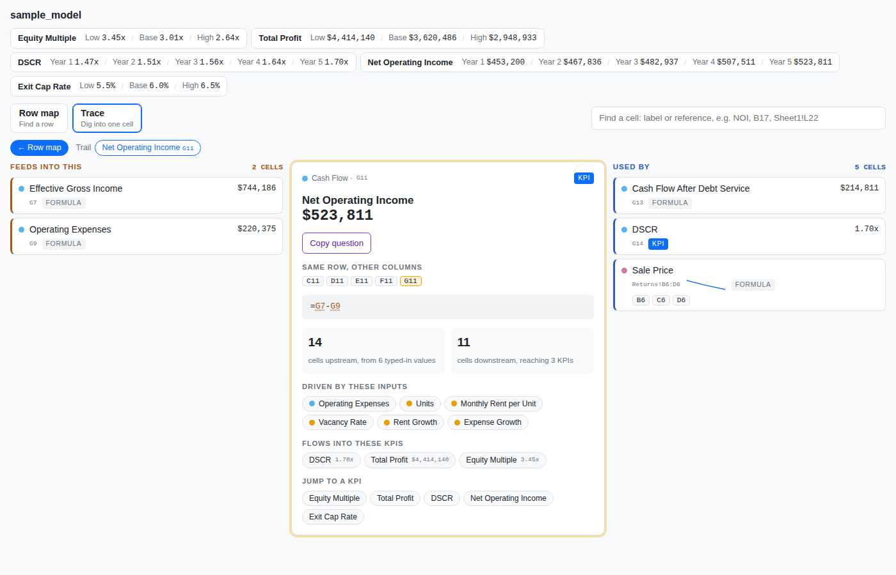

# Xlens

Ask your AI assistant why a number in an Excel financial model is what it is, and get an answer built from the workbook's real formulas, with a live one-page map beside the chat.



## What it does

Xlens reads an `.xlsx` model, builds a dependency graph from its formulas, and exposes six tools to Claude or Codex (and a CLI):

- **Map**: a one-page "Row map" of the model, grouped by sheet and row, with KPIs along the top.
- **Trace**: pick one cell and see what feeds it and what it feeds, with formulas and values.
- **Drivers**: the typed-in inputs that a cell depends on, ranked by how many paths reach it.
- **KPIs with scenarios**: IRR, NOI, DSCR, equity multiple and similar outputs, with each scenario or year column shown (Low/Base/High, Year 1 to 5).
- **Findings**: hardcoded numbers typed inside calculations, and circular references.

The assistant cites cells as `Sheet!Ref = value` and does not estimate numbers.

## Install for Claude Code

In Claude Code:

```
/plugin marketplace add akay126/xlens
/plugin install xlens@xlens
```

Or from a terminal:

```
claude plugin marketplace add akay126/xlens
claude plugin install xlens@xlens
```

The plugin adds the Xlens skill and an MCP server that runs `uvx --from xlens-ai xlens mcp`. The Claude Desktop **Code** tab uses Claude Code plugins, so the same install applies there. You need [uv](https://docs.astral.sh/uv/) installed.

The `xlens-ai` package is available on PyPI after the first release. Until then, run the server from source by pointing an MCP config at `uvx --from git+https://github.com/akay126/xlens xlens mcp`.

What was checked: with a locally modified plugin copy, Claude Code connected to the server, loaded the skill, and answered questions about `examples/sample_model.xlsx` from the tools. See [docs/install-notes.md](docs/install-notes.md). The opening of the map in a browser tab was not checked in that run.

## Install for Codex

```
codex plugin marketplace add akay126/xlens
codex plugin add xlens@xlens
```

Codex plugins can start stdio MCP servers, and this plugin does. Install, skill discovery, MCP server discovery and a direct tool call were verified with codex-cli 0.159.3. A full model session through the installed plugin was not. The `owner/repo` form of the marketplace command has not been tried yet, because the repository was not public at the time.

MCP only, without the skill:

```
codex mcp add xlens -- uvx --from xlens-ai xlens mcp
```

For any other MCP host, use a stdio server with command `uvx --from xlens-ai xlens mcp`. These `xlens-ai` commands work after the first release; before that, use `uvx --from git+https://github.com/akay126/xlens xlens mcp`.

## Claude Desktop chat (inline map)

Not yet tested. In theory, add Xlens as a manual MCP server in Claude Desktop's config so the map can show inline in chat:

```json
{
  "mcpServers": {
    "xlens": { "command": "uvx", "args": ["--from", "xlens-ai", "xlens", "mcp"] }
  }
}
```

Claude Code and Codex in a terminal do not render inline apps. There the server opens the map in your browser instead (`--no-browser` turns that off).

## Command line

```
pip install xlens-ai
```

Available after the first release. From source, use `pip install git+https://github.com/akay126/xlens`.

```
xlens analyze model.xlsx                 # full HTML report (add --output report.html)
xlens batch deal_room/                   # analyze every workbook in a folder
xlens query overview model.xlsx          # sheets, counts, flow, KPIs as JSON
xlens query find model.xlsx --text NOI
xlens query trace model.xlsx --cell "Cash Flow!G11" --direction up --depth 2
xlens query drivers model.xlsx --cell "Cash Flow!G11"
xlens query findings model.xlsx --kind hardcodes   # or circular, all
xlens mcp                                # start the MCP server over stdio
```

`xlens query` prints JSON, so scripts and agents can read it. These were run against `examples/sample_model.xlsx`. For example, the `drivers` command ranks `Inputs!B8` (Rent Growth) and `Inputs!B3` (Units) first for `Cash Flow!G11`, and `findings --kind hardcodes` flags the typed-in `Cash Flow!F9 = 215000`. `xlens mcp` takes `--no-browser` and `--no-viewer`.

## Privacy

- Xlens runs on your machine and does not upload your workbook.
- What the tools return (labels, formulas, values, cell text) becomes part of your conversation, so it goes to the AI provider behind your chat app (Anthropic for Claude, OpenAI for Codex). Check that provider's terms before using confidential models.
- The map server listens on `127.0.0.1` only, with a random token generated for each session.
- Text in a workbook is treated as untrusted. It is escaped in the map, and the skill tells the assistant not to follow instructions found in a workbook. See [SECURITY.md](SECURITY.md).

## Limits

- `.xlsx` only.
- Xlens reads the values Excel cached in the file and does not recalculate. A file written by a script without opening it in a spreadsheet app has formulas but no cached values.
- The heuristics for finding KPIs, flow blocks and assumptions are tuned for real-estate and finance models. Other kinds of workbook work, but labels may be classified less well.
- Above 1,200 rows the map shows Trace only, without the Row map.

## Development

```
uv sync --extra dev
uv run pytest                              # unit tests
uv run pytest e2e/ --browser chromium      # browser tests (needs: playwright install chromium)
python tests/fixtures/build_models.py      # regenerate the test workbooks
```

See [CONTRIBUTING.md](CONTRIBUTING.md).

## License

MIT. See [LICENSE](LICENSE).
